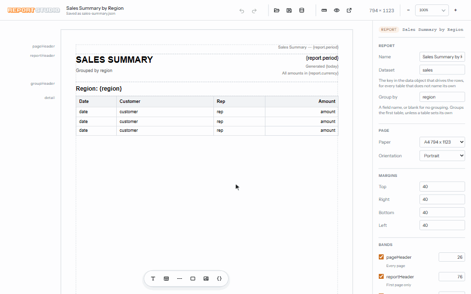

# Report Studio

**Design paginated reports visually. Zero runtime dependencies. Works in plain
JS or React.**



**[Try it live on StackBlitz](https://stackblitz.com/github/Shafickbinameer/report-studio/tree/main/examples/demo?file=src%2Fmain.js)**: the viewer and the designer in a Vite app, nothing to install.

You draw the report once in a visual designer — headers, footers, groups,
tables, text, images — and it is saved as a plain JSON file. At runtime your
app feeds that layout its own data and gets back a page-by-page report viewer,
with navigation, zoom, search, print, CSV and Excel export.

* **Zero runtime dependencies.** The renderer is plain DOM. No server to run,
  no framework required.
* **Layouts are plain JSON.** Commit them, diff them, load them with `fetch`.
* **React components included**, for both the viewer and the designer.
* **Vite plugin.** One line in `vite.config.js` and your existing dev server
  hosts the designer's save routes.
* **TypeScript types included.**

## Installation

```sh
npm install report-studio
```

Requires Node 18.3 or newer for the designer command. The viewer itself runs in
the browser and needs nothing.

## Designer setup

Start the designer from your project folder:

```sh
npx report-studio design --dir ./reports
```

`--dir` is the folder your reports are read from and saved to. It is created
for you if it does not exist. The command prints a URL and opens a browser
window on it.

Other options:

| Option | Default | What it does |
| --- | --- | --- |
| `--dir <path>` | `./reports` | where report files live |
| `--port <n>` | `5177` | port to listen on |
| `--host <addr>` | `127.0.0.1` | address to bind |
| `--tab` | — | open a normal browser tab instead of an app window |
| `--no-open` | — | do not open a browser at all |

Press `Ctrl+C` to stop it.

Saving a report called *Sales Summary* writes two files into `--dir`:

* `sales-summary.json` — the layout: page size, bands, fields, styles.
* `sales-summary.data.json` — sample data, so the designer has something to
  preview with.

The sample file is written from the layout itself, so it covers everything the
report asks for: a key for every text placeholder, a row array for every table,
and the fields your totals are taken over. Read it as the answer to "what does
my app have to supply?" — it is the shape, filled in with placeholder values.

It is created the first time a report is saved. Later saves only *add* to it,
for anything the layout has asked for since: a new table's rows, a new
placeholder's key, a new image field. Values already in the file, including
real figures you have typed in, are never changed. Your app never reads this
file; it passes its own data to `buildPages`.

The designer is a design-time tool. It reads and writes files inside `--dir`
and nowhere else — keep it on localhost and do not run it in production.

### Already using Vite?

Skip the separate command. The plugin mounts the same read-and-write routes in
the dev server you already run:

```js
import { defineConfig } from 'vite';
import { reportStudio } from 'report-studio/vite';

export default defineConfig({
    plugins: [reportStudio({ dir: 'reports' })]
});
```

Dev only, deliberately: it writes files, and mounting that in front of a
production build would be a hole rather than a feature. The CLI stays the
default because it works in any project, Vite or not.

## Preview setup

Two files: an HTML page with one empty element, and a module that fills it.

**index.html**

```html
<!DOCTYPE html>
<html lang="en">
<head>
    <meta charset="UTF-8">
    <meta name="viewport" content="width=device-width, initial-scale=1.0">
    <title>Reports</title>

    <!-- the viewer's stylesheet; the report's own styles are included in it -->
    <link rel="stylesheet"
          href="./node_modules/report-studio/src/preview/styles.css">

    <!--
        A browser resolves imports by URL and has no node_modules lookup, so the
        bare name has to be mapped to a path. If you use a bundler (Vite,
        webpack, …) it does this for you: drop the import map and the link
        above, and import the stylesheet by name instead - see below.
    -->
    <script type="importmap">
    {
      "imports": {
        "report-studio": "./node_modules/report-studio/dist/index.js"
      }
    }
    </script>

    <style>
        html, body { height: 100%; margin: 0; }
    </style>
</head>
<body>
    <!-- one empty element; the viewer builds everything inside it -->
    <div id="out" style="height: 100vh"></div>

    <script type="module" src="./main.js"></script>
</body>
</html>
```

**main.js**

```js
import { buildPages, createViewer } from 'report-studio';

// the layout file the designer saved
const layout = await fetch('./reports/sales-summary.json').then(r => r.json());

// your data, keyed by dataset name. The designer shows you the shape it
// expects; sales-summary.data.json is an example of it.
const data = {
    report: { period: 'June 2026', currency: 'USD' },
    sales: [
        { date: '2026-06-01', customer: 'Acme',  region: 'North', amount: 250 },
        { date: '2026-06-02', customer: 'Globex', region: 'South', amount: 500 }
    ]
};

createViewer({
    mount: '#out',
    paginated: buildPages(layout, data),
    title: layout.name
});
```

That is the whole integration:

* `buildPages(layout, data)` turns the layout plus your data into a page list.
* `createViewer({ mount, paginated, title })` mounts the full report viewer
  into the element you give it and returns a handle for paging, zoom, search,
  print, export and `destroy()`.

To open the report in a window of its own instead of inside your page, use
`openViewerWindow({ paginated, title })` — same viewer, called from a click or
a keypress so the browser does not block the window.

### Several tables

A report can hold any number of tables. Each one reads the dataset named in
its *Dataset* property, or the report's dataset if it names none, so each gets
its own array in your data:

```js
buildPages(layout, {
    orders:  [ { item: 'Widget', qty: 2, amount: 50 } ],
    refunds: [ { item: 'Gadget', qty: 1, amount: 20 } ]
});
```

Tables in the same band are stacked, one under another. Each splits across
pages on its own, and a table below another moves down by however far the one
above really ran. Two tables side by side are refused, because they would print
one after the other rather than together.

Totals can name the dataset they add up:

| Placeholder | Means |
| --- | --- |
| `{sum(orders.amount)}` | `amount` summed over every row of `orders` |
| `{count(refunds)}` | the number of rows in `refunds` |
| `{sum(amount)}` | `amount` over the first table's rows, as before |

The named dataset does not need a table of its own. Any array in the data can
be totalled this way.

Any number of tables can be grouped, each by a field of its own — see
[Grouping](#grouping).

For CSV, the viewer's export writes every table in the order they print. From
code, `toCSV(pages, { table: 'refunds' })` writes one table, and
`reportTables(pages)` lists the tables a report has.

For Excel, the export writes an `.xlsx` workbook with no extra dependency. It
has a *Report* sheet that reads like the report, plus one sheet per table with
a frozen, filterable header row. Numbers, booleans and dates in your data stay
numbers, booleans and dates.

The workbook keeps the report's look: fonts, sizes, colours, alignment, cell
padding, the table grid and header colours, row heights and column widths. On
the *Report* sheet each text item goes in the column under where it sits on the
page (the table columns are the grid), rows are spaced like the page, and
pictures, lines and boxes are drawn where the page has them, rounded corners
included. A box with text on it paints its fill into the cells underneath,
because Excel draws shapes above cells and a filled shape would hide the text.
A text item that prints only a placeholder's number, such as `{sum(amount)}`,
becomes a real number you can add up.

Pictures stored in the layout as `data:` URIs are embedded straight away.
Pictures loaded from URLs have to be fetched first, so the viewer's Excel
download starts a moment later for those reports. PNG, JPEG, GIF and BMP are
embedded; WebP and AVIF are left out.

From code, `toXLSX(pages)` returns the file's bytes (empty when there is
nothing to write); it embeds `data:` pictures only. `await toXLSXAsync(pages)`
fetches URL pictures first, and `reportImageSources(pages)` lists the URLs it
would fetch. Pass `{ report: false }` or `{ tables: false }` to leave a kind of
sheet out, or `{ styled: false }` for plain data with bold headers.

### Grouping

Set *Group by* on a table and its rows are split into groups by that field.
Each grouped table has its own group header, drawn above each group, and group
footer, drawn under it, so two grouped tables can look different and total
different things. In the layout file a table carries them as `grouping`:

```json
{
  "type": "table", "id": "refunds", "dataset": "refunds",
  "grouping": [{
    "by": "reason",
    "header": { "height": 24, "items": [ { "id": "reason", "type": "text", "value": "Reason: {reason}" } ] },
    "footer": { "height": 20, "items": [ { "id": "subtotal", "type": "text", "value": "Subtotal {sum(amount)}" } ] }
  }]
}
```

Inside a group band, `{reason}` is the group's value and `{sum(amount)}` adds
up that group's rows only. A group that runs over a page break prints its
header again on the next page and its footer only once, where it ends. Either
band may be `null`, but not both.

#### Ordering groups, and a page per group

By default, groups come in the order their values first appear in the data.
Each level can change that, either in the layout file or with *Order groups*
and *New page for each group* in the designer:

- `"sort": "asc"` or `"desc"` orders that level's groups by value. Numbers
  sort as numbers, so 9 comes before 10, and "Item 9" comes before "Item 10".
  Inner levels are sorted within each outer group.
- `"newPage": true` starts every group of that level on a new page, except the
  table's first group. The page repeats the column labels and every level's
  header. A group longer than a page still continues onto the next.

#### Groups within groups

A table can be grouped more than once — by region, and within each region by
city. In the designer, select a grouped table and press *Group within each
group*. Then type the field into *Then group by*. Each level can be moved out
or removed from there. In the layout file, each level is one more entry in
`grouping`, with the outermost first:

```json
"grouping": [
  { "by": "region",
    "header": { "height": 24, "items": [ { "id": "r", "type": "text", "value": "Region {region}" } ] },
    "footer": { "height": 20, "items": [ { "id": "rt", "type": "text", "value": "Region total {sum(amount)}" } ] } },
  { "by": "city",
    "header": { "height": 20, "items": [ { "id": "c", "type": "text", "value": "{city}" } ] },
    "footer": { "height": 20, "items": [ { "id": "ct", "type": "text", "value": "City total {sum(amount)}" } ] } }
]
```

- Each inner group sits inside its outer one. "Oslo" under North and "Oslo"
  under South are two separate groups.
- Each level's aggregates cover its own group. The region footer adds up the
  whole region, and the city footer adds up that city only.
- Headers print outermost first where their groups start. Footers print
  innermost first where their groups end. The last city of a region prints its
  city footer and then the region footer.
- The column labels head each outermost group, not every city.
- A page that continues a group repeats every level's header, so it still shows
  "North › Oslo". The footers that finish a group are kept on the same page as
  its last row.
- No two levels may group by the same field, and a table may be grouped at
  most 8 levels deep (`MAX_GROUP_LEVELS`).
- In CSV and XLSX exports, each level gets its own column. The columns are
  named after the fields; pass `groupLabel: ['Region', 'City']` to name them
  yourself.

Layouts written before 2.0 group with a report-wide or per-table `groupBy` and
the report's own *groupHeader* and *groupFooter* bands. They still work
unchanged, and the designer moves them onto the table when it opens them.
`normalizeGrouping(layout)` does the same from code.

### Number and date formats

Select a text item, or look at a table column's card. Then press its **Format**
button to choose how its values print. You can also right-click a text item
and choose **Format…**, or right-click a table cell and choose **Format
"Amount" column…** to format the column under the pointer. The Format Editor
offers:

- **Number, Currency or Percent:** decimal places, digit groups (`1,234,567`,
  Indian `12,34,567`, or none), how negatives show (`-1,234`, `(1,234)` or
  `1,234-`), and how zero shows (`0.00`, `-` or blank). Currency also has a
  symbol, placed before or after the number. Percent multiplies by 100, so
  `0.125` prints as `12.50%`.
- **Date or Date & time:** a layout such as `dd/MM/yyyy`, `dd-MMM-yyyy` or
  `d MMMM yyyy`, or a pattern of your own built from `yyyy MM MMM dd HH hh mm
  ss a`.
- **As it comes:** no formatting, which is the default.

A sample line shows real values as you choose. In the layout file, a format
sits on the item or the column:

```json
{ "field": "amount", "label": "Amount", "format": { "type": "currency", "decimals": 0 } }
```

**The report's defaults.** How digits are grouped, the currency symbol and the
date layout are set once for the whole report, under *Numbers and dates* on the
report rail (`layout.format`). An item's format only stores what differs from
them, so changing the report's defaults changes every format that didn't ask
for something else. A new report is neutral: `1,234,567`, no symbol, and
`2026-06-17`. **Use Indian** sets `₹`, `1,00,000` and `dd/MM/yyyy` in one
click.

```json
"format": { "grouping": "indian", "symbol": "₹", "pattern": "dd/MM/yyyy" }
```

What it applies to:

- **Table cells.** Each cell prints in its column's format, and row heights are
  measured on the printed text.
- **Text placeholders, totals and group totals.** In a text item such as
  `Total {sum(amount)}`, every placeholder prints in the item's format, and the
  words stay as typed. `{count()}` always prints as a plain count.
- **`{today}`** prints in the report's date layout, or the item's own if it has
  a date format.
- **Dates** come from the data as written (`2026-06-17`), so they never shift a
  day across time zones. Values that aren't the format's type (a name in a
  number column, an impossible date) print as they are.
- **Excel.** Numbers stay real numbers and dates become real Excel dates, each
  shown with a matching Excel number format, so the workbook still adds up and
  sorts. A text item that is a single placeholder, such as a grand total,
  becomes a formatted number on the Report sheet. Excel has no lakh grouping,
  so Indian grouping uses conditional formats (`[>=10000000]` and
  `[>=100000]`). As a result, a negative number of a lakh or more shows
  international grouping in Excel, and the "zero shows as" choice isn't carried
  over.
- **CSV** writes the values themselves (`100000`, `2026-06-17`) by default.
  Pass `{ formatted: true }` to write what's printed.

`formatValue(value, format, defaults)` and `excelNumberFormat(format, defaults)`
are exported for hosts that need the same rules.

### Calculated columns

A column can show a calculation instead of a field: type it into the
**Calculation** box on the column's card. The result is worked out for each row
and stored under the column's field, so from then on it behaves like any other
field. It's formatted and highlighted, totalled by `{sum(amount)}` in any band,
grouped and sorted by, and exported to Excel and CSV.

```json
{ "field": "amount", "label": "Amount", "expression": "{qty} * {price}", "format": { "type": "currency" } }
```

| Calculation | Gives |
|---|---|
| `{qty} * {price}` | arithmetic on fields: `+ - * / %` and brackets |
| `round({amount} * 0.18, 2)` | GST at 18%, to 2 places |
| `{amount} + {tax}` | a column can use an earlier column's result |
| `{amount} - avg({amount})` | how far each row is from the average |
| `percentage({amount})` | each row's share of the table total |
| `percentage({amount}, group)` | each row's share of its own group |
| `percentage({qty}, 500)` | each row as a share of a target |
| `max({qty}, 1)` / `abs({diff})` | the larger of two values / without the sign |

- **Totals over the table:** `sum()`, `avg()`, `min()`, `max()` and `count()`
  work over every row of the table, and can take a calculation themselves:
  `sum({qty} * {price})`.
- **Missing inputs:** if an input isn't a number (a blank, a name), or a value
  is divided by zero, the result is blank rather than an error.
- **Errors:** a calculation that can't be read is reported with what's wrong
  and where, for example `expression ends where a value is expected`.
- **Shares:** a column whose calculation is a `percentage()` prints as a
  percentage unless it has a format of its own.
- **Your data:** the rows you pass in are never changed; calculated values go
  onto copies.

### Percentages

`{percentage(...)}` gives a value as a share of another, such as each
product's share of total sales. It works in any band and prints as a
percentage.

| Placeholder | Means | Example |
|---|---|---|
| `{percentage(sum(total))}` | this group's sum ÷ the whole table's | `57.08%` |
| `{percentage(sum(total), parent)}` | this group's sum ÷ the group outside it (nested grouping) | city as a share of its region |
| `{percentage(sum(total), 50000)}` | ÷ a target | `112.40%` of target |
| `{percentage(sum(total), max(total))}` | ÷ another aggregate over the whole table | |
| `{percentage(1000)}` | a number ÷ the table's money column total | `0.09%` |
| `{percentage(count())}` | this group's rows ÷ all rows | |

- **The part** can be any aggregate (`sum`, `count`, `avg`, `min`, `max`) or a
  plain number. **What it's divided by** is optional: leave it out for the
  whole table's total, or give a number, another aggregate, or `parent`.
- **A plain number** with nothing to divide by is taken as a share of the
  table's money column: the first column formatted as currency, then as a
  number, then the right-most column that holds numbers.
- **In a report band** (not a group band), the part is the whole table, so
  `{percentage(sum(total))}` is 100%. Give a target or another aggregate
  instead.
- **How it prints:** with 2 decimals by default. Give the text item a Percent
  format to change the decimals or the negative style. It prints as a
  percentage even inside a currency-formatted item.
- **Dividing by zero:** a share of zero, or of a field with no numbers, prints
  blank.
- **Highlight rules** test the percentage as read (57.08), not the fraction.
- **Excel:** a text item that is only a percentage goes into Excel as the
  fraction (0.5708) with a `0.00%` format.
- **Designer:** "Percentage of total" is in the placeholder tool next to Sum
  and the other aggregates.

### Conditional formatting

Highlight values by what they are, like Crystal Reports' Highlighting Expert:
show negative amounts in red, shade overdue invoices, mark totals over a
target in green. Rules can go in three places:

- **A table column**, under *Highlight* on its card, or by right-clicking a
  cell and choosing *Highlight "Amount" column…*. A rule tests the cell's
  value or another field of its row, and styles that cell.
- **A table's rows**, under *Row highlight* on the table's rail, or *Highlight
  rows…* on the right-click menu. A rule tests a field of the row and styles
  every cell in it. A column's own rules are applied on top, so a red figure
  in a shaded row is both.
- **A text item**, under *Format → Highlight*. A rule tests the value it
  prints (when the item is a single placeholder such as `{sum(amount)}`), or
  any field of the data. In a group footer, it tests that group's own total.

Each rule is a condition and a style:

```json
"highlight": [
  { "when": { "op": "<", "value": 0 }, "style": { "color": "#b3261e", "fontWeight": "bold" } },
  { "when": { "op": ">=", "value": 100000 }, "style": { "color": "#1d6b3a", "background": "#e6f4ea" } }
],
"rowHighlight": [
  { "when": { "field": "status", "op": "=", "value": "Overdue" }, "style": { "background": "#fdecec" } }
]
```

- **Rule order.** Rules are checked in order, and only the first one that
  holds is used. The editor's ↑ button changes the order.
- **Tests:** equals, is not, less/more than, at most/at least, between (both
  ends included), contains, starts with, is empty, is not empty.
- **How values compare.** Numbers compare as numbers (`"1200"` counts), dates
  by their day, and text ignores case. A word is never ordered against a
  number or a date, so `"Pending" >= 1000` doesn't hold.
- **Styles:** text colour, fill, bold and italic. A rule changes only what it
  names.
- **Where it applies.** The page, its row heights (a bold cell is measured
  bold) and both Excel sheets all use the same rules. Excel cells are styled
  as printed; they aren't live Excel conditional formats.

### Images

An image item can get its picture in two ways:

* **Stored in the layout.** In the designer, click *Upload* in the image's
  properties. The picture is saved inside the layout JSON as a `data:` URI, so
  keep it small: files over 200 KB show a warning and files over 1 MB are
  refused. PNG, JPEG, GIF and WebP are accepted.
* **Read from your data.** Set *From data* to a path such as `company.logo`,
  and supply that path's URL in the data you pass to `buildPages`:

```js
buildPages(layout, {
    company: { logo: 'https://cdn.example.com/acme.png' },
    sales: [ /* ... */ ]
});
```

If an image has both, the data wins, so a stored picture works as a default
that your data can replace per customer. *Fit* controls how the picture sits in
its box: `contain` (fit inside), `cover` (fill and crop) or `fill` (stretch).

Image URLs may be `http:`, `https:`, `blob:`, relative paths, or `data:` URIs
for PNG, JPEG, GIF, WebP, AVIF and BMP. Anything else, including `javascript:`
and SVG `data:` URIs, is not drawn. Remote images must be reachable from the
viewer's page. The viewer waits for images to finish loading before it prints.

### With a bundler

Vite, webpack and the rest resolve bare names themselves, so there is no import
map and no path into `node_modules`. Import the stylesheet by name too:

```js
import { buildPages, createViewer } from 'report-studio';
import 'report-studio/viewer.css';
```

| Import | What it is |
| --- | --- |
| `report-studio` | the engine and the viewer |
| `report-studio/designer` | the designer, which most apps do not ship |
| `report-studio/viewer.css` | the viewer's styles, the report's included |
| `report-studio/designer.css` | the designer's styles, likewise |
| `report-studio/report.css` | the report alone, for drawing pages with no chrome |

The stylesheets style only what the viewer and designer draw. Your page's
fonts, margins and CSS variables are left alone. The toolbar rearranges itself
when the viewer is narrow, whether it is on a phone or in a side panel.

## React

React components are included. React itself is not bundled: install it
yourself (version 18 or newer). Apps that don't use React never load it.

```jsx
import { ReportViewer } from 'report-studio/react';
import 'report-studio/viewer.css';

function SalesReport({ layout, sales }) {
    return (
        <ReportViewer
            layout={layout}
            data={{ report: { period: 'June 2026' }, sales }}
            title={layout.name}
            style={{ height: '100vh' }}
        />
    );
}
```

* Pass `layout` and `data`, or `paginated` if you've already called
  `buildPages`.
* Give the component a height. The viewer fills it and scrolls inside it.
* When `data` changes, the report is rebuilt and the reader stays on the same
  page and zoom level. Passing the same objects again rebuilds nothing, so keep
  `data` stable (state or `useMemo`) rather than building a new object on every
  render.
* A layout or data the engine can't use throws a `ReportError` while
  rendering. Wrap the component in an error boundary to show it.
* A `ref` gives you the viewer's controls: `next()`, `prev()`, `show(index)`,
  `find(text)`, `print()`, `downloadCSV()`, `downloadXLSX()`, `setZoom(n)`, `fitWidth()`, and
  `page`, `pageCount` and `zoom`.

The designer is a separate import, like the plain-JS one:

```jsx
import { ReportDesigner } from 'report-studio/react/designer';
import 'report-studio/designer.css';

// a new report: no layout, the designer starts blank
<ReportDesigner store={store} style={{ height: '100vh' }} />

// reopening a saved report: pass it, with its id so Save writes back to it
<ReportDesigner id="sales-summary" layout={savedLayout} store={store}
    style={{ height: '100vh' }} />
```

`layout` and `id` are optional. Leave both out for a new report, and Save asks
for a name the first time.

`layout` is only where the designer *starts*, like an input's `defaultValue`.
From then on the designer owns it, so edits, selection and undo history
survive your component re-rendering. `onChange` is called after every edit,
undo and redo. It receives the designer's own object, so clone it before
storing it. To open a different report, change `id` (or the component's
`key`). `store` works as described under *Designing inside your own app*.
`createDesigner` also takes the same `onChange` option.

## Designing inside your own app

The command above is the usual way in, and it is a whole application. If you
would rather put the designer in a page of your own — an admin screen where
your users build their own reports — mount it the same way you mount the
viewer: one empty element, and it builds the rest inside it.

```js
import { createDesigner } from 'report-studio/designer';
import 'report-studio/designer.css';

const designer = createDesigner({
    mount: '#design',
    layout,                 // a saved layout, or omit for a blank report
    id: 'sales-summary',    // its filename stem, if it has one
    store                   // where Open and Save read and write; see below
});
```

`store` is how the designer reaches your reports. Leave it out and it talks to
the dev server the CLI runs, which is what the bundled designer page does.
Supply your own to save through your API instead:

```js
const api = '/api/reports';
const json = { 'content-type': 'application/json' };

const store = {
    // required: Open, and Save
    list: async () => fetch(api).then(r => r.json()),
    load: async (id) => fetch(`${api}/${id}`).then(r => r.json()),
    save: async (id, layout) => fetch(`${api}/${id}`,
        { method: 'PUT', headers: json, body: JSON.stringify(layout) }),

    // optional: the sample data the designer previews with. Without these two
    // the preview falls back to data derived from the layout, which is a
    // working designer - just one that never remembers your figures.
    loadData: async (id) => fetch(`${api}/${id}/data`)
        .then(r => (r.ok ? r.json() : null)),
    saveData: async (id, data) => fetch(`${api}/${id}/data`,
        { method: 'PUT', headers: json, body: JSON.stringify(data) }),

    // optional: Delete, in the report picker
    remove: async (id) => fetch(`${api}/${id}`, { method: 'DELETE' })
};
```

`list` returns `{ id, name }` objects — the picker shows the name and opens the
id. `loadData` must resolve to `null`, not throw, when a report has no data
file yet: that is an ordinary state, not a failure.

Give the mount element a height, as you do for the viewer. The designer fills
it, so your own header or tabs can sit above it. An element with no height
gets the full window.

`createDesigner` returns a handle with the current `layout`, `redraw()` and
`destroy()`. `openDesignerWindow(options)` opens the same designer in a window
of its own, for the same reason `openViewerWindow` does.

## TypeScript

Type declarations ship with the package, for every entry point. Nothing to
install. The layout file has types of its own, so a layout loaded from JSON can
be checked:

```ts
import { buildPages, createViewer, type Layout } from 'report-studio';

const layout: Layout = await fetch('./reports/sales-summary.json')
    .then(r => r.json());
```

`Layout`, `ReportItem`, `PaginatedReport`, `ViewerHandle`, `ReportStore`,
`DesignerHandle` and the component props are all exported as types.

## Licence

MIT